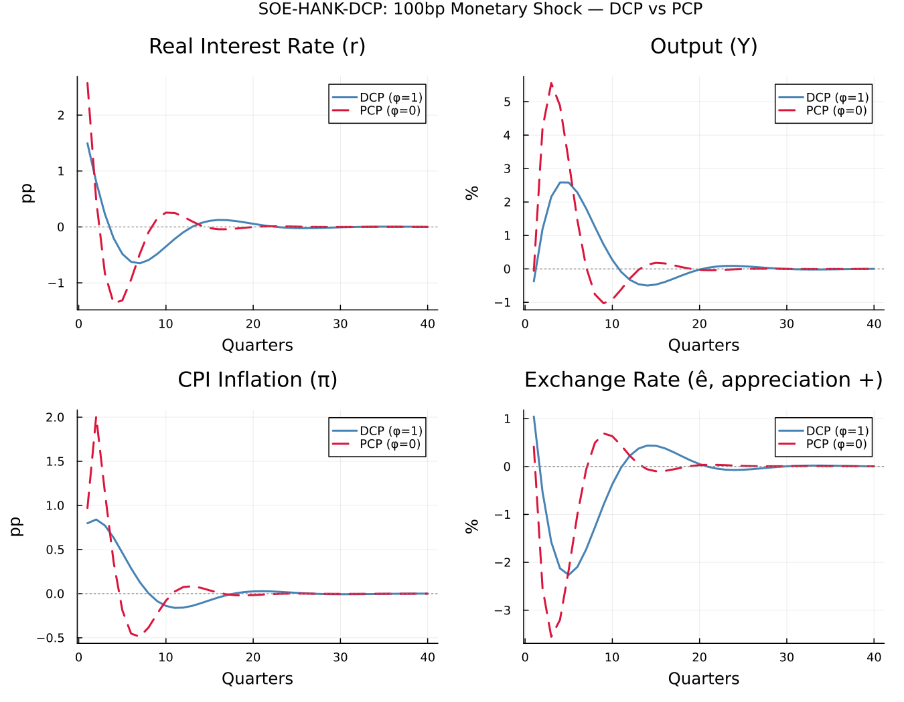
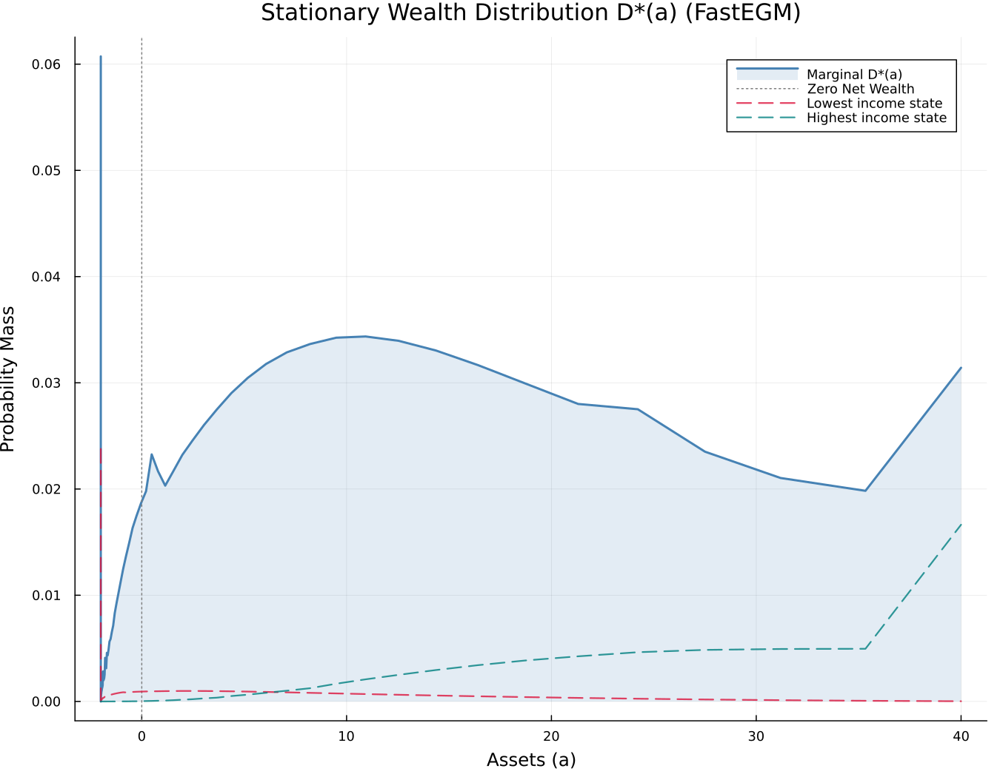
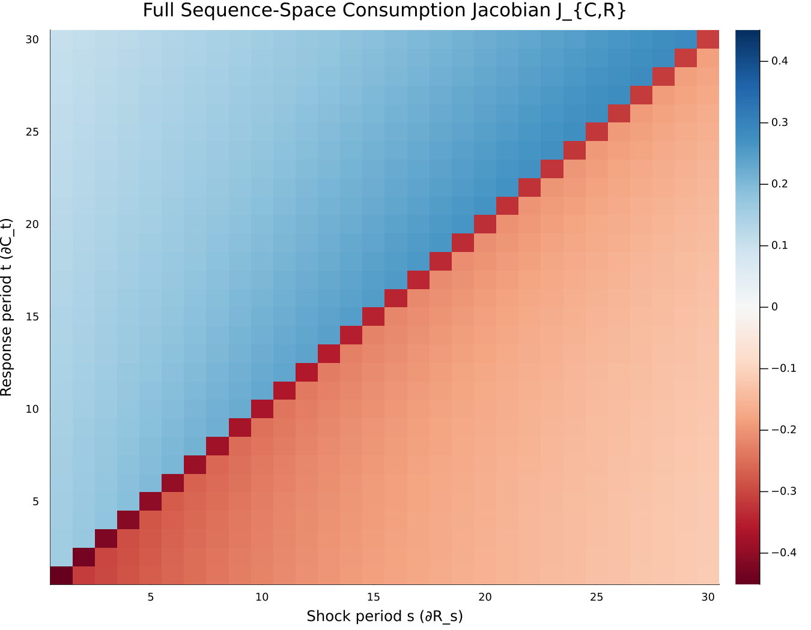

# SOE-HANK-DCP

A Small Open Economy Heterogeneous-Agent New Keynesian (SOE-HANK) model with **Dominant Currency Pricing (DCP)** vs. **Producer Currency Pricing (PCP)**, solved in Julia using the **Sequence-Space Jacobian (SSJ)** framework of Auclert, Bardóczy, Rognlie, and Straub (2021, *Econometrica*).

---

## Model & Computational Architecture

1. **Zero-Allocation Household Block (`FastEGM.jl`):**
   - Solves the infinite-horizon incomplete-markets consumption-savings problem with idiosyncratic Rouwenhorst (1995) labor productivity risk and a binding borrowing limit ($a_t \ge \underline{a}$) via the Endogenous Grid Method (Carroll, 2006).
   - Computes the ergodic wealth-income distribution $D^*(a, y)$ using the Young (2010) non-stochastic lottery method.

2. **Full Non-Toeplitz Sequence-Space Jacobians (`src/SSJEngine.jl`):**
   - Implements the Auclert et al. (2021) Fake-News algorithm to construct full $T \times T$ household Jacobians ($\mathcal{J}_{C,r}, \mathcal{J}_{A,r}, \mathcal{J}_{C,Y}, \mathcal{J}_{A,Y}$), capturing both backward distributional transition dynamics and forward-looking Euler anticipation effects.

3. **Open-Economy DAG & Exact GE Inversion (`src/open_economy_dag.jl`):**
   - **Monetary Policy & Fisher Equation:** Inertial Taylor rule with real interest rate feedback.
   - **Exchange Rate (UIP):** Forward-looking Uncovered Interest Parity with risk-premium damping ($\rho_e$).
   - **Import Price Pass-Through (Gopinath et al., 2020):** Blends Dominant Currency Pricing ($\phi = 1$, sticky USD import/export invoicing) and Producer Currency Pricing ($\phi = 0$, complete exchange-rate pass-through $\pi_t^M = -(1-\phi)\Delta e_t$).
   - **Exact Linear Solver:** Solves the coupled general equilibrium system $H_U \cdot dU = -H_Z \cdot dZ$ via direct matrix inversion so open-economy goods market clearing holds to machine precision ($\sim 10^{-16}$).

---

## Quickstart

### Interactive REPL Execution

```julia
using Pkg
Pkg.activate(".")
Pkg.instantiate()

include("src/SOE_HANK_DCP.jl")
using .SOE_HANK_DCP: Params, run_model

# Compare Dominant Currency Pricing (φ = 1) vs. Producer Currency Pricing (φ = 0)
res_dcp = run_model(p = Params(φ = 1.0, ϕ_Y = 0.125, T = 60, n_a = 150, n_y = 5))
res_pcp = run_model(p = Params(φ = 0.0, ϕ_Y = 0.125, T = 60, n_a = 150, n_y = 5))
```

### Command-Line Scripts

From the repository root folder (`SOE-HANK-DCP/`) in your terminal:

```bash
# Regenerate all figures in plots/
julia --project scripts/produce_irfs.jl

# Run the full 15-test verification suite
julia --project test/runtests.jl
```

---

## Key Results

### 1. 100bp Monetary Policy Tightening: DCP ($\phi = 1$) vs. PCP ($\phi = 0$)


### 2. Ergodic Wealth Distribution $D^*(a, y)$


### 3. Full Sequence-Space Consumption Jacobian $\mathcal{J}_{C,r}$


---

## Repository Structure

```text
SOE-HANK-DCP/
├── Project.toml               # Dependencies (including FastEGM.jl)
├── Manifest.toml              # Reproducible lockfile
├── src/
│   ├── SOE_HANK_DCP.jl        # Main module & top-level run_model() pipeline
│   ├── parameters.jl          # Structural parameters, asset grid, Rouwenhorst process
│   ├── SSJEngine.jl           # Auclert et al. (2021) Fake-News Jacobian engine
│   ├── open_economy_dag.jl    # Taylor rule, UIP, DCP/PCP pricing, NKPC, exact GE solver
│   ├── household_block.jl     # Baseline EGM utilities
│   ├── steady_state.jl        # Ergodic distribution & Walrasian market-clearing checks
│   └── fake_news.jl           # Legacy Toeplitz Fake-News utilities
├── scripts/
│   └── produce_irfs.jl        # Generates IRF, distribution, and Jacobian plots
├── test/
│   └── runtests.jl            # Unit & general-equilibrium market-clearing tests
└── plots/
    ├── irf_monetary_shock.png
    ├── stationary_distribution.png
    └── jacobian_heatmap.png
```

---

## References

- Auclert, A., Bardóczy, B., Rognlie, M., & Straub, L. (2021). *Using the Sequence-Space Jacobian to Solve and Estimate Heterogeneous-Agent Models*. **Econometrica**, 89(5), 2375–2408.
- Gopinath, G., Boz, E., Casas, C., Díez, F. J., Gourinchas, P.-O., & Plagborg-Møller, M. (2020). *Dominant Currency Paradigm*. **American Economic Review**, 110(3), 677–719.
- Carroll, C. D. (2006). *The Method of Endogenous Gridpoints for Solving Dynamic Stochastic Optimization Problems*. **Economics Letters**, 91(3), 312–320.
- Young, E. R. (2010). *Solving the Incomplete Markets Model with Aggregate Uncertainty Using the Krusell–Smith Algorithm and Non-Stochastic Simulations*. **Journal of Economic Dynamics and Control**, 34(1), 36–41.
