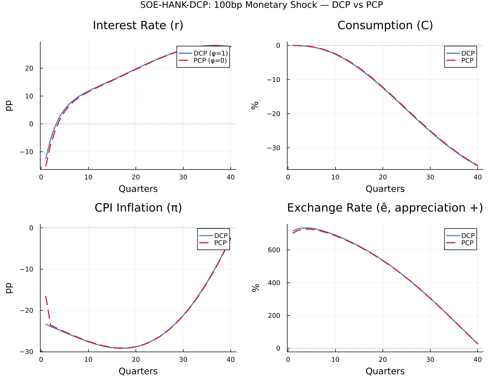
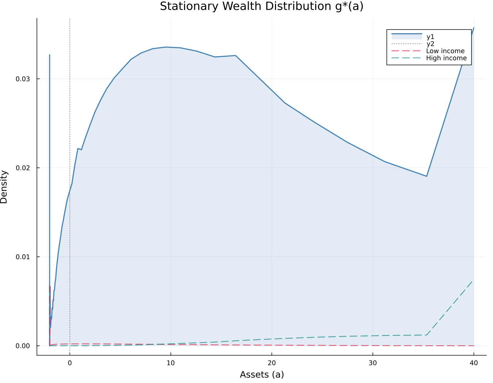
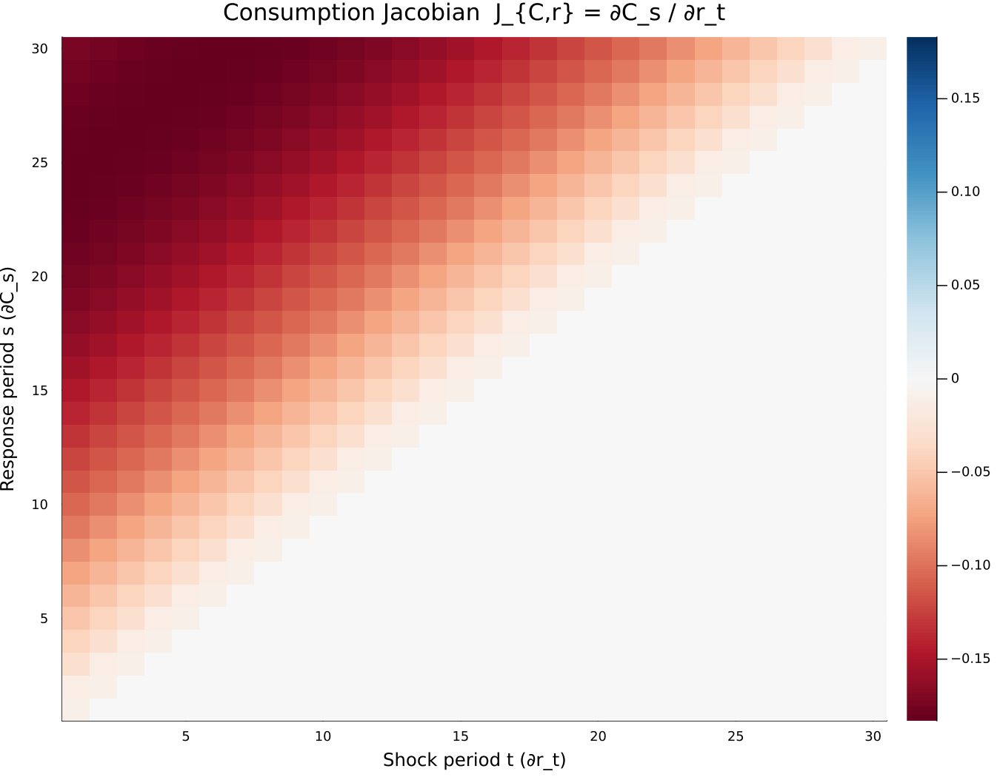

[](https://github.com/anujagokhale1604/SOE-HANK-DCP/actions/workflows/CI.yml)

# SOE-HANK-DCP

**Small Open Economy HANK with Dominant Currency Pricing**  
*Anuja A. Gokhale · October 2026*

---

## Overview

This repository implements a quantitative **heterogeneous-agent New Keynesian (HANK)** model of a small open economy (SOE) where import prices are set in a dominant currency (USD), following the Dominant Currency Paradigm (DCP) of Gopinath et al. (2020).

The model is solved entirely in **Julia** using the **Sequence-Space Jacobian** (SSJ) method of Auclert, Bardóczy, Rognlie & Straub (2021, *Econometrica*).

### The Economic Question

When a small open economy central bank raises rates by 100bp, two forces act on household consumption in opposite directions:

| Channel | Mechanism | Direction |
|---|---|---|
| **Cash-flow squeeze** | Higher mortgage servicing costs reduce disposable income of indebted households | ↓ C |
| **Expenditure-switching (DCP)** | Currency appreciation lowers import prices; real wages rise | ↑ C |

The model quantifies the **net impulse response** and shows how the DCP degree (φ ∈ [0,1]) determines which channel dominates.

---

## Model

### Households

A continuum of households faces uninsurable idiosyncratic labour income risk:

$$\log y_{it} = \rho_y \log y_{it-1} + \sigma_y \varepsilon_{it}, \quad \varepsilon_{it} \sim \mathcal{N}(0,1)$$

Households choose consumption $c_{it}$ and savings $a_{it+1}$ to maximise:

$$\mathbb{E}_0 \sum_{t=0}^\infty \beta^t u(c_{it}), \quad u(c) = \frac{c^{1-\gamma}}{1-\gamma}$$

subject to the budget constraint:

$$c_{it} + a_{it+1} = (1 + r_t) a_{it} + w_t y_{it}, \quad a_{it+1} \geq \bar{a}$$

The borrowing constraint $\bar{a} < 0$ generates a mass of **Hand-to-Mouth** (HtM) households endogenously — those at the constraint exhibit high MPCs and drive the cash-flow channel.

### Dominant Currency Pricing

Import prices are sticky in USD. Under full DCP (φ = 1), a domestic currency appreciation does not pass through to import inflation:

$$\pi_t^M = (1-\phi) \cdot \Delta \hat{e}_t$$

where $\hat{e}_t$ is the log exchange rate (appreciation positive). This blends DCP (φ=1, no pass-through) with PCP (φ=0, full pass-through).

### Exchange Rate (UIP)

$$\hat{e}_t = \mathbb{E}_t \hat{e}_{t+1} + r_t - r^*$$

Under rational expectations: $\hat{e}_t = \sum_{s \geq 0} r_{t+s}$.

### Taylor Rule

$$i_t = \rho_i i_{t-1} + (1-\rho_i)[\phi_\pi \pi_t + \phi_Y \hat{Y}_t] + \varepsilon_t^{MP}$$

### Phillips Curve (NKPC)

$$\pi_t^H = \beta \mathbb{E}_t \pi_{t+1}^H + \kappa \hat{Y}_t$$

---

## Computational Methods

### 1. Endogenous Grid Method (EGM)

The household's consumption function is solved by inverting the Euler equation:

$$u'(c_t) = \beta(1+r) \mathbb{E}_t[u'(c_{t+1})] \implies c_t = (u')^{-1}\!\left(\beta(1+r)\mathbb{E}_t[u'(c_{t+1})]\right)$$

This avoids a constrained optimisation at each grid point. Policy functions converge in ~500 iterations.

### 2. Stationary Distribution (Kolmogorov Forward)

The stationary distribution $g^*(a, y)$ is computed via the **Young (2010) lottery method**: a sparse transition matrix $Q$ maps the distribution forward until convergence:

$$g^* = Q \cdot g^*, \quad \sum_{a,y} g^*(a,y) = 1$$

### 3. Sequence-Space Jacobians (Fake-News Algorithm)

The aggregate consumption Jacobian $\mathcal{J}_{C,r}[s,t] = \partial C_s / \partial r_t$ is assembled via:

$$\mathcal{J}[s,t] = \mathbf{E}[s-t, :] \cdot \mathbf{D}[:, 1]$$

where:
- **curly-E** $\mathbf{E}[s, i]$: present-value consumption response of household-state $i$ to a cash-on-hand shock $s$ periods later (propagated via $Q$)
- **curly-D** $\mathbf{D}[:, t]$: change in the cross-sectional distribution $t$ periods after a rate shock (lottery-method perturbation)

### 4. GE Solution (Sequence-Space DAG)

All blocks are linearised and solved simultaneously:

$$\mathbf{H}_U \cdot dU = -\mathbf{H}_Z \cdot dZ$$

where $U = [\hat{Y}, \pi^H, r]$ are endogenous sequences and $Z = [\varepsilon^{MP}]$ is the shock.

---

## Results

### Impulse Response Functions: 100bp Monetary Shock

*DCP (φ=1) vs PCP (φ=0)*



Under DCP, the expenditure-switching channel is **attenuated**: currency appreciation does not lower import prices, so the real income offset is smaller. The cash-flow squeeze therefore dominates — consumption contracts more persistently under DCP than PCP.

### Stationary Wealth Distribution



The endogenous wealth distribution shows significant mass at the borrowing constraint — these are the HtM households whose consumption is most sensitive to the mortgage cash-flow shock.

### Consumption Jacobian Heatmap



$\mathcal{J}_{C,r}[s,t]$ is lower-triangular (future rate changes do not affect past consumption). The diagonal captures the contemporaneous MPC; off-diagonal entries capture the intertemporal propagation via the distribution dynamics.

---

## Repository Structure

```
SOE-HANK-DCP/
├── src/
│   ├── SOE_HANK_DCP.jl         # Main module
│   ├── parameters.jl           # @with_kw Params struct, grids, income process
│   ├── household_block.jl      # EGM backward solver
│   ├── steady_state.jl         # Kolmogorov forward, market clearing
│   ├── fake_news.jl            # curly-E, curly-D, Jacobian assembly
│   └── open_economy_dag.jl     # Taylor rule, UIP, DCP, NKPC, GE DAG
├── test/
│   ├── runtests.jl             # Unit tests (income process, EGM, distribution, Jacobian)
│   └── test_jacobians.jl       # Fake-news vs. finite-difference Jacobian check
├── scripts/
│   └── produce_irfs.jl         # Runs shock experiment, saves all plots
├── plots/
├── Project.toml
└── README.md
```

---

## Quick Start

```julia
# From the repo root:
using Pkg; Pkg.activate("."); Pkg.instantiate()

# Run all tests:
include("test/runtests.jl")

# Run full model and produce plots:
include("scripts/produce_irfs.jl")

# Or use the module directly:
include("src/SOE_HANK_DCP.jl")
using .SOE_HANK_DCP
results = run_model(verbose=true)
```

---

## Parameters

| Parameter | Value | Description |
|---|---|---|
| β | 0.98 | Discount factor (quarterly) |
| γ | 2.0 | CRRA coefficient |
| ρ_y | 0.966 | Income persistence (Flodén & Lindé 2001) |
| σ_y | 0.170 | Income shock std |
| r_ss | 0.005 | Steady-state real rate (~2% annual) |
| α_M | 0.30 | Import share |
| η | 1.5 | Home-import substitution elasticity |
| φ | 0.0–1.0 | DCP degree (0=PCP, 1=full DCP) |
| ϕ_π | 1.5 | Taylor rule inflation coefficient |
| κ | 0.1 | NKPC slope |
| n_a | 200 | Asset grid points |
| n_y | 7 | Income grid points |
| T | 200 | Sequence-space horizon |

---

## References

- Auclert, A., Bardóczy, B., Rognlie, M., & Straub, L. (2021). Using the Sequence-Space Jacobian to Solve and Estimate Heterogeneous-Agent Models. *Econometrica*, 89(5), 2375–2408.
- Carroll, C. D. (2006). The Method of Endogenous Gridpoints for Solving Dynamic Stochastic Optimization Problems. *Economics Letters*, 91(3), 312–320.
- Gopinath, G., Boz, E., Casas, C., Díez, F. J., Gourinchas, P. O., & Plagborg-Møller, M. (2020). Dominant Currency Paradigm. *American Economic Review*, 110(3), 677–719.
- Kaplan, G., Moll, B., & Violante, G. L. (2018). Monetary Policy According to HANK. *American Economic Review*, 108(3), 697–743.
- Young, E. R. (2010). Solving the Incomplete Markets Model with Aggregate Uncertainty Using the Krusell-Smith Algorithm and Non-Stochastic Simulations. *Journal of Economic Dynamics and Control*, 34(1), 36–41.

---

*This model is part of a research program on open-economy monetary transmission, dominant currency pricing, and heterogeneous household responses to monetary policy.*
